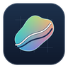

# ICC Profile Analyzer



Fristående macOS-app för numerisk utvärdering av ICC v2/v4. Öppna en profil och lägg vid behov till en andra för jämförelse. Appen läser profilerna och sparar analysen som en engelsk PDF-rapport eller en separat JSON-fil. Jämförelse och kurvor visas i samma engelskspråkiga fönster.

## Installera på macOS

Hämta [DMG-filen för Apple Silicon](https://github.com/chto0703009/ICCProfileAnalyzer/releases/latest), öppna den och dra appen till **Program**. Appen har engelska menyer. Klicka på **Quit** uppe till höger för att avsluta.

[Svensk PDF-guide](docs/ICC-Profile-Analyzer-SV.pdf) · [English PDF guide](docs/ICC-Profile-Analyzer-EN.pdf)

- **Assessment** visar vit- och svartpunkt, tonomfång, uppskattad absolut och relativ gamutvolym och observationer om neutralitet och kurvjämnhet.
- **Gamut by L*** visar modellens a*/b*-punkter vid vald ljushet. Vid jämförelse visas skillnad i största samplade kroma per nyanssektor.
- **Curves and smoothness** visar L*, a*/b*, kroma, nyans och färgavstånd per steg. För perceptuell återgivning och relativ med svartpunktskompensation följer analysen kedjan sRGB → enhetsvärden → absolut Lab D50.
- **ICC Tags** visar header, tagglista, datatyper, storlekar, positioner, kontrollsummor och läsbara text- och XYZ-fält.
- **Open Measurements** jämför RGB-profiler mot en CGATS/TI3 med RGB 0–100 och Lab D50 eller XYZ D50 där Y=100 motsvarar referensvitt. Ange mätfilens relation till profilerna. ΔE00 redovisas som medel, p95 och max, med delresultat för skuggor och neutraler.

Kurv- och gamutanalysen stöder enhetsprofiler för RGB, CMYK och gråskala. Övriga ICC v2/v4 visas som metadata. CMYK-samplingen begränsas till 300 % total färgmängd och den rapporterade svarta ändpunkten är rent K. Volymen är ett konvext hölje kring de samplade Lab-punkterna. Metoden kan överbrygga konkaviteter och kan ge andra volymtal än en metod som integrerar en detaljerad gamutgräns. Oberoende utskriftsmätning behövs för att bedöma träffsäkerhet.

**Save PDF** inkluderar bedömning, mätstatistik, L*-snitt, kurvor för valt återgivningsläge och ICC-taggar.

Guiderna följer med i DMG-filen.

## Kör källkoden och bygg appen

Använd Python med Tkinter och LittleCMS 2. På Apple Silicon används här Homebrews LittleCMS-bibliotek. PyInstaller inkluderar det i appen.

```sh
python3 -m venv .venv
.venv/bin/python -m pip install -r requirements.txt pyinstaller==6.20.0
.venv/bin/python app.py
.venv/bin/python -m PyInstaller --windowed --name 'ICC Profile Analyzer' --icon resources/Analyzer.icns \
  --osx-bundle-identifier se.borgasundsfotografiska.iccprofileanalyzer \
  --add-binary /opt/homebrew/lib/liblcms2.2.dylib:. \
  --collect-submodules scipy._external.array_api_compat \
  --add-data LittleCMS-LICENSE.txt:. --add-data resources:resources app.py
```

Kör testerna med `.venv/bin/python -m unittest`. Bygg om PDF-guiderna med `PYTHONPATH=. .venv/bin/python docs/build_guides.py`. Ikonen kan återskapas med `.venv/bin/python tools/build_icon.py` på macOS.

## License

The application and the color math from InkProf are licensed under [GNU GPL version 3 or later](LICENSE) (`GPL-3.0-or-later`). [LittleCMS is MIT-licensed](LittleCMS-LICENSE.txt). See the [DejaVu font notices](resources/DejaVuSans.ttf.notices.txt) for the embedded report font.
